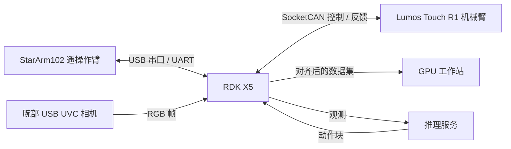

# 架构与模块边界

| 组件 | 责任 | 当前入口 |
| --- | --- | --- |
| 主机探测 | 枚举 Linux 设备节点和 SocketCAN 接口 | `lumos-runtime inspect` |
| 遥操作臂串口 | 读取六轴和夹爪，现场原型可下发启动对齐目标 | 合作方遥操作工程与 X5 实验原型 |
| 启动对齐预览 | 通过校准映射反算遥操作臂的六轴目标 | `lumos-runtime plan-startup-alignment` |
| 机械臂控制 | 在 X5 读取 CAN 反馈、管理使能及发送控制命令 | 合作方遥操作工程 |
| 视觉 | 从 X5 的 V4L2 设备读取腕部 RGB 图像，可扩展全局相机 | 合作方数采工程 |
| 遥操作与数据 | 管理校准和跟随，记录源时间戳并离线对齐数据 | 合作方现场工程 |
| 训练及推理 | 在工作站训练和推理，X5 管理实际动作执行 | 合作方训练和部署流程 |

## 接口约定

- 主臂优先用 `/dev/serial/by-id/` 的稳定路径。现场主臂数据链路是 1 Mbps。X5 自己的调试串口是另一条链路。
- 从臂使用经典 CAN，1 Mbps。板载 CAN 或 USB-CAN 的接口名以 X5 实测为准。
- 腕部 USB UVC 相机直连 X5。数采先以彩色 640×480、30 fps 为目标。视频节点编号会随设备枚举变化。
- 校准、设备路径和现场报告按设备单独管理。导入 Python 包和运行接口探测时，机械臂保持当前状态。
- X5 负责现场动作的使能、限位和停机。推理服务只返回动作，真机测试由现场操作者开始和停止。

参照 [OpenArm Runtime](https://github.com/Edge-Intelligence-Lab/openarm-runtime) 的包结构和文档组织。此处接口参数依据 Lumos/X5 现场手册。
